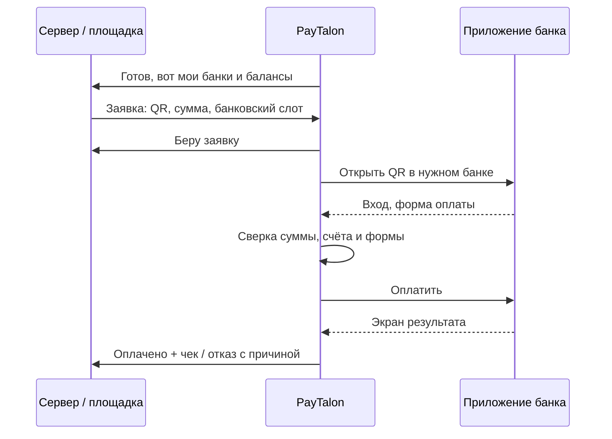

# PayTalon AutoPay

**Автоматическая оплата СБП-заявок с Android-телефона — без ручного ввода QR и выбора банка**

Заявка приходит → приложение само открывает нужный банк → проверяет платёж → оплачивает → отправляет результат с чеком.

[Банки](#-банки) · [Как это работает](#-как-это-работает) · [Интеграция](#-интеграция-с-вашим-софтом-или-площадкой) · [Связаться](https://t.me/jaims)

- **Полностью автоматический цикл.** Телефон сам получает заявку, открывает банк, вводит PIN, проверяет форму, нажимает «Оплатить» и ждёт ответа банка.
- **Шесть банков** и любое число их копий на одном устройстве.
- **Сколько угодно телефонов** в одном рабочем круге — заявки распределяются по готовым банкам.
- **Контроль баланса.** Банк с остатком ниже порога сам выходит из работы и сам возвращается после пополнения.
- **Оплата засчитывается только по подтверждению банка.** Само нажатие кнопки оплатой не считается.
- **Чек сохраняется**, результат сразу уходит на сервер.
- **Подключается к вашему софту или площадке** — по готовому HTTP-протоколу или под ключ.

---

## Банки

| Банк | Приложение | Готовность |
|---|---|---|
| **Т-Банк** | Т-Банк | 🟢 Стабильно, рабочая нагрузка |
| **Ozon Банк** | Ozon Банк | 🟢 Стабильно, рабочая нагрузка |
| **ЮMoney** | ЮMoney | 🟢 Готов |
| **МТС Деньги** | МТС Деньги (и старое «МТС Банк») | 🟢 Готов |
| **Яндекс Банк** | Яндекс Пэй | 🟡 Готов частично |
| **ВБ Банк** | WB Кошелёк в Wildberries | 🟡 Готов частично  |

🟢 — работает стибильно · 🟡 — автоматизация готова, но могут возникать сбои, которые я помогу исправить.

**Новые банки добавляются по запросу:** Нужен только 1 банк или свой набор? Собираем отдельную версию приложения только с нужными банками — в ней нет лишних модулей.

---

## Как это работает

### Серверный режим

После запуска приложение подключается к настроенным серверам и начинает получать новые заявки.

Вставлять QR и каждый раз выбирать банк не нужно: заявка приходит **уже с назначенным банковским слотом**. Приложение само открывает нужный банк, проверяет платёж и выполняет оплату.

### Копии банковских приложений

Поддерживаются системные копии приложений (клоны). Каждая копия — **отдельный банковский слот** со своими настройками, состоянием, балансом и неснижаемым остатком. Можно подключить несколько приложений 1 банка и использовать их как отдельные точки оплаты.

### Слежение за каждым слотом

Для каждого подключённого банка и копии приложение отслеживает:
- включён ли он в автооплату
- установлено ли банковское приложение
- выполнен ли вход
- готов ли банк принимать платежи
- какой баланс доступен
- не достигнут ли минимальный остаток

Если баланс опустился ниже порога, слот **исключается** из автооплаты, и заявки идут в другой готовый банк или копию. После пополнения и обновления баланса слот **сам возвращается** в работу. Если ни один банк не готов, недоступен или пуст — новые оплаты не запускаются. Сервер продолжает работать и ждёт, когда появится подходящий слот.

### Несколько устройств

На одном устройстве одновременно обрабатывается **одна заявка**. Чтобы увеличить поток, подключите несколько телефонов: все они попадают в общий круг и получают заявки с учётом своих банков и их состояния. Подходят и обычные, и облачные телефоны.

## Интеграция с вашим софтом или площадкой
### Ваш собственный backend

PayTalon подключается к вашему серверу. Достаточно реализовать **три HTTP-метода**.
- HTTPS или HTTP с подписью HMAC-SHA256.
- Документация, OpenAPI-спецификация и готовые JSON-примеры в комплекте.
- Можно проверить контракт без телефона.
- Один телефон может работать с несколькими серверами.

### Интеграция под ключ

Подключу автооплату к вашей площадке, CRM или процессингу. Разберём ваш поток заявок, настроим протокол и проверим на ваших устройствах.

## FAQ

<b>Нужно ли держать телефон в руках?</b>

Нет. После настройки телефон работает сам. Достаточно, чтобы он был включён, подключён к сети и не отключал PayTalon в фоне.

<b>Что будет, если на счёте кончатся деньги?</b>

Слот уйдёт из работы, как только баланс упадёт ниже заданного порога. Заявки пойдут в другие банки. После пополнения слот вернётся сам.

<b>Может ли один платёж пройти дважды?</b>

Повторное нажатие оплаты по той же заявке заблокировано, в том числе после перезапуска и потери связи. Если результат неизвестен, приложение ждёт банк, а не платит снова.

<b>Что если банк обновит приложение?</b>

Мы следим за изменениями экранов банков и выпускаем обновления PayTalon. Если форма стала неузнаваемой, автооплата не нажмёт кнопку вслепую — заявка просто не будет оплачена.

<b>Можно подключить несколько аккаунтов одного банка?</b>

Да, через системные копии приложения. Каждая копия — отдельный слот со своим балансом и настройками.

<b>Сколько телефонов можно подключить?</b>

Сколько указано в лицензии, вплоть до безлимита. Каждый телефон обрабатывает одну заявку за раз.

